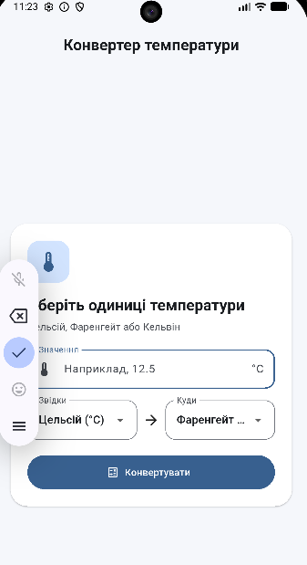
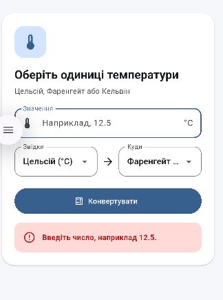
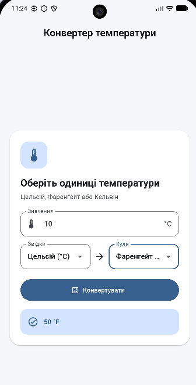

# Конвертер температури

Flutter-застосунок для конвертації між градусами Цельсія, Фаренгейта та Кельвіна.

## Запуск на Android-емуляторі

```powershell

flutter pub get
flutter devices
flutter run -d <ID_емулятора>
```


Спочатку запустіть віртуальний телефон в Android Studio через **Device Manager**. Команда `flutter devices` покаже його ID, наприклад `emulator-5554`.

## Можливості

- Введення числа з клавіатури та вибір початкової й кінцевої одиниць.
- Конвертація після натискання кнопки або Enter.
- Зрозуміле повідомлення для некоректного введення та температури нижче абсолютного нуля.
- Окремий клас для обчислень у `lib/temperature_converter.dart`.
- Звільнення `TextEditingController` у `dispose()`.

## Перевірка

- `flutter analyze` — без попереджень і помилок.
- Застосунок запущено на Android-емуляторі; зроблено скриншоти початкового екрана, помилки введення та результату `10 °C → 50 °F`.
- Flutter показав команди Hot Reload (`r`) і Hot Restart (`R`); у цьому запуску їх не викликали.

## Скриншоти

Початковий екран:



Повідомлення про некоректне введення:



Результат конвертації:


